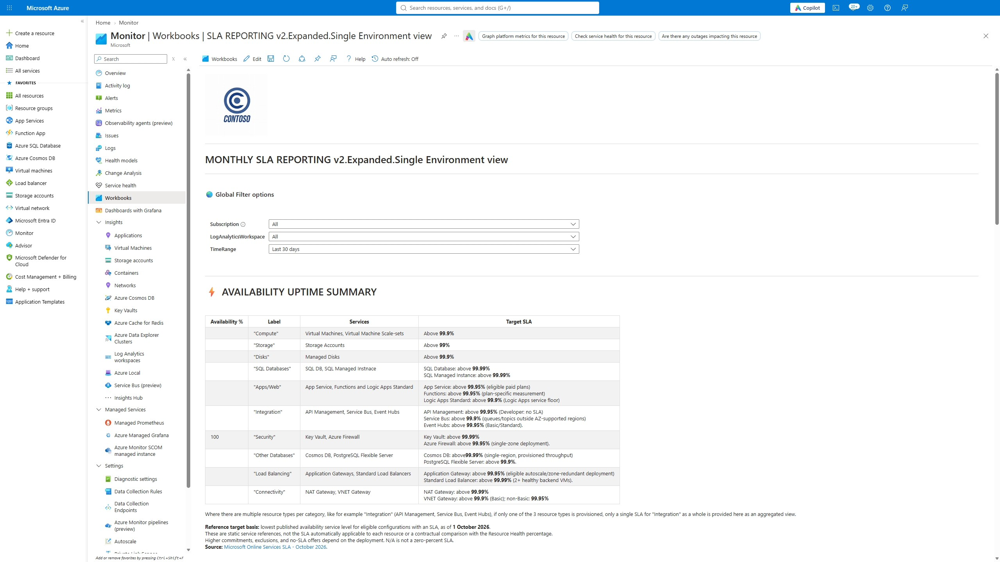
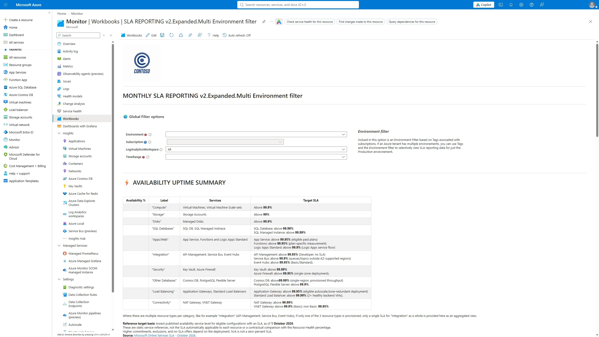

# Azure Workbook for SLA Reporting

This repository contains an Azure Monitor Workbook that calculates an Azure Resource Health availability baseline across selected subscriptions, Log Analytics workspaces, and reporting periods.

The workbook presents:

- A summary of availability percentages by workload category.
- Detailed tables showing category, resource count, eligible minutes, unavailable minutes, and availability.
- Global filters for subscriptions, Log Analytics workspaces, and a reporting period.
- Export-to-Excel support for the detailed tables.

> [!IMPORTANT]
> The workbook reports availability derived from Azure Resource Health state transitions in the Azure Activity Log. 
> It is an operational availability baseline, not a contractual Azure SLA calculation, service-credit determination, or end-to-end application uptime measurement.


Screenshot 01:



Screenshot 02:


The screenshots show an earlier version; the current workbook includes the additional categories and state-counting rules below.


## Repository structure

```text
.
|-- README.md
`-- Workbook
    `-- workbook.json
`-- Images
    `-- Screenshot--01.jpeg
    `-- Screenshot--02.jpeg
```

`Workbook/workbook.json` contains the Azure Workbook definition and embedded KQL queries.

## Workload coverage

| Workbook category | Azure resource types                                                                                  | Measurement                                                             |
| ----------------- | ----------------------------------------------------------------------------------------------------- | ----------------------------------------------------------------------- |
| Compute           | `Microsoft.Compute/virtualMachines`, `Microsoft.Compute/virtualMachineScaleSets`                      | Direct Resource Health state                                            |
| Storage           | `Microsoft.Storage/storageAccounts`                                                                   | Direct Resource Health state                                            |
| Disks             | `Microsoft.Compute/disks`                                                                             | Attached VM Resource Health used as a proxy                             |
| SQL databases     | `Microsoft.Sql/servers/databases`, `Microsoft.Sql/managedInstances`                                   | Direct Resource Health state                                            |
| Apps/Web          | `Microsoft.Web/sites`                                                                                 | Direct Resource Health state                                            |
| Integration       | `Microsoft.ApiManagement/service`, `Microsoft.ServiceBus/namespaces`, `Microsoft.EventHub/namespaces` | Direct Resource Health state                                            |
| Security          | `Microsoft.KeyVault/vaults`, `Microsoft.Network/azureFirewalls`                                       | Direct Resource Health state                                            |
| Databases         | `Microsoft.DocumentDB/databaseAccounts`, `Microsoft.DBforPostgreSQL/flexibleServers`                  | Direct Resource Health state                                            |
| Load Balancing    | `Microsoft.Network/applicationGateways`, `Microsoft.Network/loadBalancers`                            | Direct Resource Health state; Load Balancers are scoped to Standard SKU |
| Connectivity      | `Microsoft.Network/natGateways`, `Microsoft.Network/virtualNetworkGateways`                           | Direct Resource Health state; VNET Gateways and NAT Gatways             |

The Apps/Web category includes App Service, Azure Functions, and Logic Apps Standard. Consumption Logic Apps use `Microsoft.Logic/workflows` and are not included because they do not provide the same Resource Health signal.

App Service Environments are not counted as separate resources. Applications hosted in an App Service Environment are included through their individual `Microsoft.Web/sites` resources.

The five additional groups cover 13 service types. Service Bus and Event Hubs are measured at namespace level, Cosmos DB at account level, and PostgreSQL at flexible-server level. Child queues, event hubs, databases, containers, listeners, backends, tunnels, and peers are not separately counted.

Virtual Network Gateways are limited to `properties.gatewayType =~ "Vpn"`. Connections are limited to `properties.connectionType in~ ("IPsec", "Vnet2Vnet")`. ExpressRoute circuits are included as their own resource type; ExpressRoute gateways and ExpressRoute connection subtypes are not inferred from circuit or peer health. Unsupported Load Balancer SKUs are not included.

All additions use the resource's native Resource Health state. The workbook does not convert request-success percentages, backend probes, per-instance or peer signals, or the `FirewallHealth` metric into availability minutes. The pre-existing managed-disk VM proxy remains explicitly labelled and is not a direct resource-health measurement.

See Microsoft's [supported Resource Health types](https://learn.microsoft.com/en-us/azure/service-health/resource-health-checks-resource-types), [Resource Health Activity Log schema](https://learn.microsoft.com/en-us/azure/azure-monitor/fundamentals/activity-log-schema#resource-health-category), and [Firewall Resource Health states](https://learn.microsoft.com/en-us/azure/firewall/monitor-firewall-reference#resource-health-states-and-events).

## Workbook output

The five existing detailed workload queries return one aggregate row each. The additional groups return one row per service present in the current inventory:

| Column | Description |
| --- | --- |
| `Category` | Workload or service label |
| `Resources` | Number of distinct inventory resources included, including resources with no measured time |
| `EligibleMinutes` | `AvailableMinutes + UnavailableMinutes`; excludes other or unmeasured states |
| `UnavailableMinutes` | Resource-minutes where Resource Health reported `Unavailable` |
| `Availability` | Available minutes as a percentage of eligible minutes, rounded to four decimal places; blank when eligible minutes are zero |

Every Availability Detail query projects exactly `Category`, `Resources`, `EligibleMinutes`, `UnavailableMinutes`, and `Availability`, in that order. `AvailableMinutes` remains part of the calculation but is not displayed. The separate `Availability_*` summary parameters intentionally project only `Availability`; they are not the detailed queries.

For example, three resources over a 60-day period have the following eligible time only if their entire timelines are known to be `Available` or `Unavailable`:

```text
3 resources x 60 days x 24 hours x 60 minutes = 259,200 eligible minutes
```

Availability is calculated as:

```text
Availability % =
100 x Available minutes / (Available minutes + Unavailable minutes)
```

In every detailed view, `EligibleMinutes` is rounded to a whole minute and `UnavailableMinutes` to two decimal places. Percentages are calculated from unrounded durations. Group summary percentages pool available and unavailable minutes across their services; they are not an unweighted average of service percentages.

`Degraded` and `Unknown` transitions remain in the timeline so they end preceding intervals, but their durations are excluded from both minute totals and the denominator. Missing initial history is also excluded. A resource with no usable state history has zero eligible minutes and a blank availability percentage, not an assumed 100%.

## Prerequisites

### Azure Activity Log export

The selected subscriptions must export their Azure Activity Log to at least one selected Log Analytics workspace. The export must include the `ResourceHealth` category.

Resource Health records appear in the `AzureActivity` table and describe changes in Azure's health assessment for individual resources.

Common states are:

| State | Meaning |
| --- | --- |
| `Available` | Azure detects no issue affecting the resource |
| `Unavailable` | Azure detects that the resource cannot provide its expected service |
| `Degraded` | The resource remains available but has reduced performance or functionality |
| `Unknown` | Azure does not currently have enough health information |

### Permissions

Workbook users require:

- Read access to the selected subscriptions and resources so Azure Resource Graph can build the inventory.
- Query access to the selected Log Analytics workspaces, such as the **Log Analytics Reader** role.
- Access to the workbook resource itself.

### Log Analytics workspace scope

The `LogAnalyticsWorkspace` parameter supports multiple selections. Each Logs query is scoped through the workbook's `crossComponentResources` setting:

```json
"crossComponentResources": [
  "{LogAnalyticsWorkspace}"
]
```

The KQL therefore references:

```kusto
AzureActivity
```

rather than:

```kusto
workspace({LogAnalyticsWorkspace}).AzureActivity
```

`workspace()` accepts one workspace expression and cannot consume the comma-separated values produced by a multi-select parameter. Workbook resource scoping allows Azure Monitor to query all selected workspaces collectively.

## Global parameters

The workbook defines three global filters.

### `subscriptionID`

A required, multi-select subscription parameter. Queries compare the selected ARM subscription paths to the subscription GUIDs in Azure Resource Graph and `AzureActivity` by normalizing them:

```kusto
where strcat("/subscriptions/", subscriptionId) in~ ({subscriptionID})
```

The `AzureActivity` schema uses an uppercase column name:

```kusto
where strcat("/subscriptions/", SubscriptionId) in~ ({subscriptionID})
```

This case difference is intentional.

### `LogAnalyticsWorkspace`

A required, multi-select resource parameter populated from Azure Resource Graph:

```kusto
resources
| where type =~ "microsoft.operationalinsights/workspaces"
| project value = id, label = id, selected = true
```

It controls the workspace scope for all downstream Logs queries. The query's third column selects all discovered workspace resource IDs by default. The parameter does not persist `value::all` as its initial `value` or `defaultValue`; the optional **All** command remains available in the picker. This avoids relying solely on restoration of a special saved selection to establish the Logs resource scope.

Defaults do not overwrite a user's subsequent selections. After changing subscriptions, use **Default Items** to reapply the query defaults or select the desired workspaces explicitly. If discovery returns no workspaces, the scope remains empty; the workbook does not substitute an unrelated workspace.

#### Troubleshooting "No resources are selected"

`No resources are selected. Please select {LogAnalyticsWorkspace}.` is a workbook resource-scope message raised before the availability KQL runs.

Select the intended subscriptions first, then confirm that **Log Analytics workspaces** contains one or more actual workspace selections. After importing an updated workbook, use **Default Items** or explicitly select the workspaces if an older selection is retained. If the picker is empty, check subscription scope and permission to discover the workspaces.

When editing a Logs query control, its workspace/resource selector must be bound to `LogAnalyticsWorkspace`. Copying the KQL alone into a separate control does not copy that control's resource scope. The workbook already binds every availability summary and detail query with `crossComponentResources: ["{LogAnalyticsWorkspace}"]`; do not replace `AzureActivity` with a multi-value `workspace()` call to address this message.

### `TimeRange`

A required time-range parameter with the existing selectable values:

- Last 24 hours
- Last 30 days
- A custom interval

Queries use the parameter boundaries directly:

```kusto
let StartTime = {TimeRange:start};
let EndTime = {TimeRange:end};
```

Logs query time context is **Set in query** (`timeContext.durationMs = 0`). The explicit KQL bounds include the 90-day state lookback; an additional workbook time-range constraint must not truncate that history to the reporting interval.

## How the KQL works

All workload queries follow the same general pipeline.

### 1. Define the reporting interval

```kusto
let StartTime = {TimeRange:start};
let EndTime = {TimeRange:end};
```

The calculation uses exact parameter timestamps rather than assuming calendar-month boundaries.

### 2. Read Activity Log data

```kusto
let SourceActivity =
    AzureActivity
    | where strcat("/subscriptions/", SubscriptionId) in~ ({subscriptionID})
    | where TimeGenerated between ((StartTime - 90d) .. EndTime);
```

The extra 90-day lookback finds the last known state before `StartTime`. This matters when a resource became unavailable before the selected reporting period and recovered during it.

### 3. Validate that the selected workspace scope has data

```kusto
let ActivityRows = toscalar(
    SourceActivity
    | summarize count());
```

The final pipeline includes:

```kusto
| where ActivityRows > 0
```

With this guard, no result row is returned when the selected workspace scope contains no matching `AzureActivity` records for the selected subscriptions and lookback period.

This check proves only that some Activity Log data exists in the selected scope. It does not establish Resource Health coverage. The unknown initial seed, not this guard, prevents missing per-resource history from becoming assumed available minutes.

### 4. Discover resources with Azure Resource Graph

Each query uses:

```kusto
arg("").Resources
```

to build a current resource inventory. The resource-type filter changes by workload category.

The inventory then uses a small cross-service bridge:

```kusto
| extend JoinKey = 1
| join hint.remote=right kind=inner (
    print JoinKey = 1
) on JoinKey
```

This forces subsequent processing onto the Log Analytics side. It is required because operators later in the query, including `serialize`, are not supported by Azure Resource Graph. Without the bridge, Azure Monitor can push too much of the query to Resource Graph and return a parser failure.

### 5. Normalize Resource Health events

Queries filter:

```kusto
CategoryValue in~ ("ResourceHealth", "Resource Health")
```

They support both the newer dynamic `Properties_d` field and the older string `Properties` field:

```kusto
extend P = iif(
    isnotempty(tostring(Properties_d)),
    Properties_d,
    parse_json(Properties))
```

The current state is normalized across schema variants:

```kusto
extend State = tolower(tostring(
    coalesce(
        P.currentHealthStatus,
        P.healthStatus)))
```

Resource IDs are converted to lowercase so Resource Graph inventory IDs and Activity Log IDs join consistently.

Events are joined to the inventory by exact resource ID before reconstructing intervals. For direct categories, `HealthResourceId` equals the inventory resource ID. Only the existing disk proxy uses the attached VM's ID instead. This prevents child resources, out-of-scope subtypes, and historical resources absent from the current inventory from entering a category through broad path matching.

State strings are normalized to lowercase. Duplicate events for a resource at the same timestamp are collapsed; conflicting state values at that timestamp are treated as `Unknown`.

### 6. Seed and reconstruct each timeline

Each inventory resource receives a baseline row:

```kusto
EventTime = StartTime,
State = "Unknown",
Priority = 0
```

If a Resource Health event exists before the reporting period, its latest state overrides the baseline with priority `1`. Events inside the reporting period have priority `2`.

Without prior history, time before the first recorded state remains unmeasured. The workbook does not infer an available starting state from a lack of incidents, a current resource inventory, or unrelated Activity Log records.

```kusto
| summarize arg_max(Priority, State, Service) by ResourceId, EventTime
```

After sorting each resource's transitions, `next()` determines when the current state ends:

```kusto
| sort by ResourceId asc, EventTime asc
| serialize
| extend
    NextResourceId = next(ResourceId),
    NextEventTime = next(EventTime)
```

The interval ends at the next event for the same resource or at `EndTime`. All four states participate in this step; filtering out `Unknown` or `Degraded` before finding the next event would incorrectly extend a preceding known state across excluded time.

### 7. Aggregate resource-minutes

```kusto
| summarize
    Resources = dcount(ResourceId),
    AvailableMinutes = sumif(
        IntervalMinutes,
        State =~ "Available"),
    UnavailableMinutes = sumif(
        IntervalMinutes,
        State =~ "Unavailable")
    by Service
| extend EligibleMinutes = AvailableMinutes + UnavailableMinutes
```

Durations use `(IntervalEnd - EventTime) / 1m`. Only `Available` and `Unavailable` contribute to eligible time. If their sum is zero, availability is null.

The summary section uses global parameters such as `Availability_VM`, `Availability_SQL`, and `Availability_Integration`, which run equivalent queries but pool service minutes and project only `Availability`. Every detailed query retains its resource/service aggregation and projects the five output columns described above.

### Reference target SLAs

The summary table lists service-specific minimum published availability service levels from the [Microsoft Online Services SLA dated 1 October 2026](https://www.microsoft.com/licensing/docs/documents/download/OnlineSvcsConsolidatedSLA(WW)(English)(October_2026)(CR).docx), available through Microsoft's [SLA document index](https://www.microsoft.com/licensing/docs/view/Service-Level-Agreements-SLA-for-Online-Services).

"Minimum" means the lowest published availability commitment among eligible configurations with an SLA, not the lowest service-credit payout band, a guarantee for every SKU, or a target derived from the current resource inventory. Configurations with no SLA are exceptions, not zero-percent SLAs. These references do not change the KQL, determine pass/fail, or establish service-credit eligibility.

| Service                        | Minimum published reference                | Eligibility and higher commitments                                                                                                                                                                                                                                                                                                                  |
| ------------------------------ | ------------------------------------------ | --------------------------------------------------------------------------------------------------------------------------------------------------------------------------------------------------------------------------------------------------------------------------------------------------------------------------------------------------- |
| Virtual Machines               | 95%                                        | Eligible single-instance VM using Standard HDD managed disks. Standard SSD: 99.5%; eligible Premium SSD/Premium SSD v2/Ultra configuration: 99.9%. Mixed disks use the lowest applicable disk SLA. Eligible multi-instance availability-set/host-group deployments: 99.95%; multiple zones: 99.99%. Spot VMs have no SLA.                           |
| Virtual Machine Scale Sets     | VM SLA; 95% eligible single-instance floor | Scale sets share VM SLA terms; disk configuration, instance count, and fault-domain/zone topology determine eligibility. The multi-instance 99.95%/99.99% commitments are not automatic merely because a scale set exists.                                                                                                                          |
| Storage accounts               | 99%                                        | Lowest listed commitment is for eligible Cool/Cold/Archive write requests. Hot/transaction-optimized operations have a 99.9% baseline; qualifying read-access geo-redundant hot reads have 99.99%. These are operation/tier-specific request SLAs, not one unconditional account-uptime promise. Offline archive payload reads require rehydration. |
| Managed disks                  | N/A                                        | No independent disk availability SLA; disks are covered within VM SLA terms. The workbook retains its explicitly labelled attached-VM Resource Health proxy.                                                                                                                                                                                        |
| SQL Database                   | 99.99%                                     | Eligible paid databases/pools. Qualifying zone-redundant General Purpose, Business Critical, Premium, or Hyperscale: 99.995%. Free offers have no guaranteed SLA.                                                                                                                                                                                   |
| SQL Managed Instance           | 99.99%                                     | Eligible paid instances with compliant networking. Qualifying zone-redundant General Purpose or Business Critical: 99.995%. Free offers have no guaranteed SLA.                                                                                                                                                                                     |
| App Service                    | 99.95%                                     | Eligible paid, non-zone-redundant apps; qualifying apps across two or more availability zones: 99.99%. Free/Shared plans and retired ASE v1/v2 workloads have no SLA.                                                                                                                                                                               |
| Azure Functions                | 99.95%                                     | Consumption measures successfully triggered executions; Flex Consumption, Premium, and Dedicated measure function-app trigger availability. The common number does not make those contractual measurements equivalent to Resource Health minutes.                                                                                                   |
| Logic Apps Standard            | 99.9% Logic Apps service reference         | The consolidated Logic Apps section lists 99.9%; its separate App Service section includes eligible hosted Logic Apps at 99.95% (higher with qualifying zone redundancy). The displayed minimum is the Logic Apps service floor, not an execution-success or downstream-system guarantee. Retired ISE is not covered.                               |
| API Management                 | 99.95%                                     | Consumption, Basic, Standard, and single-region Premium baseline; qualifying multi-region Premium: 99.99%. Developer has no SLA. Tier/deployment eligibility must be checked separately.                                                                                                                                                            |
| Service Bus                    | 99.9%                                      | The baseline table covers queues/topics outside regions with availability-zone support. Premium in an AZ-supported region has 99.99% terms. Do not infer a namespace-specific commitment from the minimum reference alone.                                                                                                                          |
| Event Hubs                     | 99.95%                                     | Basic/Standard; Premium/Dedicated: 99.99%. The current consolidated legal document, rather than conflicting general architecture guidance, supplies this baseline.                                                                                                                                                                                  |
| Key Vault                      | 99.99%                                     | Covered vault transactions; vault/key/secret creation, update, and deletion are excluded transactions under the SLA. This row does not cover Managed HSM.                                                                                                                                                                                           |
| Azure Firewall                 | 99.95%                                     | Single-zone baseline; qualifying deployment across two or more zones: 99.99%.                                                                                                                                                                                                                                                                       |
| Cosmos DB                      | 99.99%                                     | Single-region provisioned-throughput availability. Single-region with zones: 99.995%; qualifying multi-region read or multi-write availability: 99.999%. Serverless is not assigned an inferred commitment from tables explicitly scoped to provisioned throughput.                                                                                 |
| PostgreSQL Flexible Server     | 99.9%                                      | Without HA; same-zone HA: 99.95%; zone-redundant HA: 99.99%. Burstable v2 capacity/performance and other documented exclusions still apply.                                                                                                                                                                                                         |
| Application Gateway            | 99.95%                                     | Eligible autoscale/zone-redundant deployment configured for HTTP load balancing. Preview Basic is not used as a GA floor, and retired v1 has no SLA.                                                                                                                                                                                                |
| Standard Load Balancer         | 99.99%                                     | Serving at least two healthy backend VMs. SNAT exhaustion is excluded. Basic has no SLA and is outside the workbook scope.                                                                                                                                                                                                                          |
| NAT Gateway                    | 99.99%                                     | Azure VNet NAT terms require at least two healthy VMs; SNAT exhaustion is excluded. This value is from the October 2026 legal document, not an inferred uplift based on SKU or zone redundancy.                                                                                                                                                     |
| VPN Gateway                    | 99.9%                                      | Basic gateway baseline; non-Basic gateway terms: 99.95%. The reference is not selected automatically from each gateway SKU.                                                                                                                                                                                                                         |


The table intentionally retains a group row while listing each service's reference separately. A pooled group's observed percentage is not a contractual SLA for any one member service. Actual commitments can be higher, and billing-period definitions, qualifying operations, networking requirements, exclusions, and claim rules differ from the workbook's Resource Health calculation.

Supplementary sources for scope and no-SLA exceptions:

- [VM Scale Sets SLA relationship](https://learn.microsoft.com/en-us/azure/reliability/reliability-virtual-machine-scale-sets#service-level-agreement) and [Spot VM limitations](https://learn.microsoft.com/en-us/azure/virtual-machines/spot-vms).
- [Managed disks have no independent availability SLA](https://learn.microsoft.com/en-us/azure/reliability/reliability-storage-disk#service-level-agreement).
- [App Service Free/Shared plans](https://azure.microsoft.com/en-us/pricing/details/app-service/windows/) and [API Management tier support](https://learn.microsoft.com/en-us/azure/api-management/api-management-features).
- [SQL Database free-offer SLA exception](https://learn.microsoft.com/en-us/azure/azure-sql/database/free-offer-faq?view=azuresql) and [SQL Managed Instance free-offer limits](https://learn.microsoft.com/en-us/azure/azure-sql/managed-instance/free-offer?view=azuresql#free-offer-limits).
- [Application Gateway v1 retirement](https://learn.microsoft.com/en-us/azure/application-gateway/v1-retirement).

## Differences between workload queries

The timeline and aggregation logic is shared. The important differences are inventory selection, event filtering, and resource normalization.

### Virtual machines and VM Scale Sets

Inventory types:

```kusto
where type in~ (
    "microsoft.compute/virtualmachines",
    "microsoft.compute/virtualmachinescalesets")
```

Exact inventory-ID matching distinguishes standalone VMs from VM Scale Sets and prevents child instance paths from being counted accidentally.

Each VM Scale Set is counted as one resource. Individual VMSS instances are not counted separately.

### Storage accounts

Inventory type:

```kusto
where type =~ "microsoft.storage/storageaccounts"
```

Only events for exact storage-account inventory IDs are used. Blob, File, Queue, and Table child-service events are not counted as separate resources or substituted for the parent account's health.

Managed disks are not included in this category because they are `Microsoft.Compute/disks` resources and do not expose an equivalent independent Resource Health availability signal.

### Managed disks

Inventory type:

```kusto
where type =~ "microsoft.compute/disks"
| where isnotempty(managedBy)
```

Only attached disks are included. `managedBy` identifies the associated VM:

```kusto
HealthResourceId = tolower(tostring(managedBy))
```

Managed disks do not provide independent Resource Health availability events. The disk query therefore:

1. Reads Resource Health transitions for standalone VMs.
2. Joins each attached disk to its managing VM.
3. Applies the VM state to the disk timeline.

The result is labelled `Managed disks (VM proxy)` because it represents host-VM availability, not a direct disk SLA or independent disk-health measurement.

### Azure SQL Database and SQL Managed Instance

Inventory types:

```kusto
where type in~ (
    "microsoft.sql/servers/databases",
    "microsoft.sql/managedinstances")
```

The query excludes Azure SQL Database `master` databases:

```kusto
where not(
    type =~ "microsoft.sql/servers/databases"
    and (
        name =~ "master"
        or tolower(id) endswith "/databases/master"))
```

For SQL Managed Instance, the managed instance is counted at the parent resource level. Child MI databases are excluded to prevent one managed instance from being counted once for the instance and again for every database.

Azure SQL Database is counted at the database resource level because Resource Health supports `Microsoft.Sql/servers/databases`.

### App Service, Functions, and Logic Apps Standard

Inventory type:

```kusto
where type =~ "microsoft.web/sites"
```

All three workloads share `Microsoft.Web/sites` and remain pooled in the existing Apps/Web row. Deployment slots have the child type `Microsoft.Web/sites/slots`, so the inventory type filter and exact ID join exclude them.

This avoids counting both a production app and each of its slots as separate top-level applications.

Consumption Logic Apps are not included because they use `Microsoft.Logic/workflows`. App Service Environment resources are also not counted separately, although apps hosted in an environment remain included as `Microsoft.Web/sites`.

### Additional direct Resource Health groups

Integration, Security, Databases, Load Balancing, and Connectivity share the same state timeline and calculation as the existing direct categories. Their inventories map the 13 supported ARM resource types to service labels, producing separate service rows within each group.

For Azure Firewall, all instances unhealthy or unreachable can produce `Unavailable`; partial instance failures and SNAT pressure can produce `Degraded`, which is excluded. For PostgreSQL HA, a failover with connectivity impact can be `Degraded`; it is not relabelled `Unavailable`. Load Balancer and NAT Gateway states use Azure's own health thresholds. The workbook reports time in those native states without recreating or converting the underlying thresholds.

Resource-type support does not prove that each SKU or resource has usable state history. A supported inventory resource with no matching native state data remains unmeasured.

## Assumptions and limitations

### Resource Health is not end-to-end uptime

Resource Health represents Azure's assessment of a resource. It does not directly measure whether users could complete a business transaction or reach an application endpoint. Use Application Insights availability tests or another synthetic-monitoring solution for customer-observed uptime.

### The initial state is unmeasured without history

If no earlier transition is found in the 90-day lookback, the resource starts with an `Unknown` seed. Its initial interval is excluded until a recorded state is available. An always-healthy resource that emitted no transitions in the retained history can therefore have no measured time. Lack of incidents is not treated as proof of historical availability.

### Current inventory is used

Azure Resource Graph supplies the inventory at query time. As a result:

- A resource deleted before the workbook runs is absent even if it existed during the reporting period.
- Creation and deletion timestamps are not used to reconstruct the full historical lifetime of a resource.

For strict historical asset eligibility, creation and deletion timestamps must be stored and incorporated separately.

### Empty data and missing tables are different

If the selected workspace scope contains `AzureActivity` but no matching health transition for a resource, that resource retains the unknown seed: its measured minute totals are zero and its percentage is blank.

If no relevant `AzureActivity` rows exist, `ActivityRows > 0` suppresses the output. If the `AzureActivity` table does not exist at all in a selected query scope, Azure Monitor can return a table-resolution error before the guard executes.

### Activity Log retention and collection start

The workbook cannot report events that were never exported or that are outside available retention. Configure Activity Log export before relying on the report, and retain the data for at least the maximum reporting period plus the 90-day state lookback.

### Short and unknown transitions

Not every Resource Health transition is recorded in the Activity Log. For example, some short VM unhealthy periods and certain transitions to or from `Unknown` can be omitted. The queries exclude recorded `Unknown` intervals but cannot reconstruct unknown transitions that Azure did not emit. Retained event timestamps define this operational state-duration report, not a complete continuous uptime ledger.

### Availability uses only known binary states

`Available` contributes to the numerator and denominator; `Unavailable` contributes only to the denominator. Recorded `Degraded`, `Unknown`, conflicting states, and missing initial history contribute to neither. Eligible minutes may be less than the selected reporting period multiplied by the resource count. A high percentage with little eligible time must not be interpreted as full-period coverage.

### Managed disks are a proxy

The managed-disk result inherits the state of the attached standalone VM. It does not independently prove disk availability, and disks whose `managedBy` resource does not match the standalone VM event model do not receive correlated health transitions.

### Azure Resource Graph cross-service limit

The `arg()` cross-service query returns at most the first 1,000 Resource Graph records. The workbook is intended for scopes below that limit.

## Import the workbook

1. Open **Azure Monitor** in the Azure portal.
2. Select **Workbooks** and create a new workbook.
3. Open the workbook's advanced editor.
4. Replace the template JSON with the contents of `Workbook/workbook.json`.
5. Apply the changes and save the workbook.
6. Select the subscriptions, Log Analytics workspaces, and reporting period.

If a category returns no row, confirm that:

1. At least one selected workspace contains `AzureActivity`.
2. The selected subscriptions export Activity Log data to the selected workspace scope.
3. The user has query permission on every selected workspace.
4. The selected subscription and workspace parameters are populated before downstream queries run.

## Interpretation guidance

Use this workbook to:

- Establish a consistent Resource Health availability baseline.
- Compare broad workload categories over the same reporting period.
- Identify whether Azure reported unavailable time for selected resources.
- Export aggregate results for operational reporting.

Do not use the workbook alone to:

- Determine Azure service-credit eligibility.
- Replace service-specific SLA terms.
- Prove end-user or application availability.
- Measure independent managed-disk health.
- Reconstruct an authoritative historical inventory.

For formal reporting, label the result **Azure Resource Health availability** and retain the selected subscriptions, workspaces, reporting period, query version, and workbook version with the exported result.
